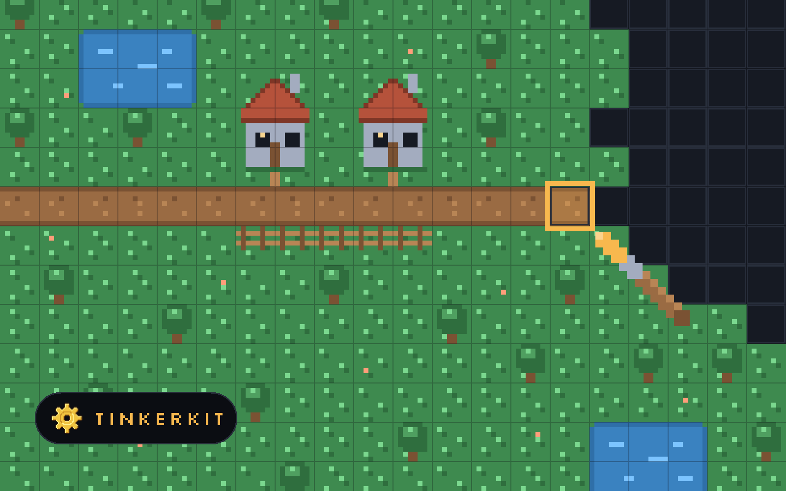

# cover-art

A Claude Code plugin with one skill, `cover-art`: a full-bleed, representational
cover illustration for a website, app, extension or Claude skill, with the
project's logo in a dark pill bottom left. Give it a repo (or a URL) and it
reads the project's purpose, design tokens and any hero visual, finds its logo
and brand font, picks one of five concept patterns, draws a 1600 × 1000 SVG
with a script, checks it at full and card size, and delivers it with alt text,
plus a 1600 × 900 Ko-fi PNG of the same cover for announcing the project or an
update, a 1200 × 630 share image for link previews (`og:image`), and a
1080 × 1080 square SVG and PNG for an Instagram post.



## Install

In Claude Code (2.1.275 or later):

```
/plugin install cover-art --marketplace mtblck/cover-art
```

Or add the marketplace first, which works on older versions too:

```
/plugin marketplace add mtblck/cover-art
/plugin install cover-art@cover-art
```

To have it in every session on a repo (including Claude Code on the web), add
this to the repo's `.claude/settings.json`:

```json
{
  "extraKnownMarketplaces": {
    "cover-art": { "source": { "source": "github", "repo": "mtblck/cover-art" } }
  },
  "enabledPlugins": { "cover-art@cover-art": true }
}
```

It's also in [mtblck/claude-marketplace](https://github.com/mtblck/claude-marketplace)
as `cover-art@mtblck`, pinned to a commit of this repo.

## Use

Ask for a cover: "make a cover for mtblck/inlaytrace", "draw a portfolio
thumbnail for this repo". The skill reads the project first, then draws.

The rule it works from is "one verb, one picture": draw the one thing the
product does, in the product's own colours, with the accent only on that part.

- `scripts/render.mjs` renders a cover at 1600 px and 380 px for review, and
  the 16:9 Ko-fi PNG and the 1200 × 630 share image (Node 18+; uses Playwright's Chromium only if it's already
  installed), and a square SVG as a 1080 × 1080 PNG.
- `scripts/square.mjs` cuts the square SVG from a cover: a 1000 px window of the
  scene (`--center` picks where), with the pills moved into its bottom corners
  (Node 18+, no dependencies).
- `scripts/logo_pill.py` draws the logo pill: the project's mark and its
  wordmark set in the brand font as paths, and (`--npm`) the npm pill a
  project on npm gets bottom right (Python 3 with Pillow and fontTools).
- `examples/` holds covers made for mattblack.space: Tinkerkit in the current
  full-bleed, logo-pill style, and seven earlier ones made while the style guide
  was worked out (Inlay, Collated, Bot Collector, Timeboxed, RetroRail, isogram,
  Does It Pencil), which are centred and have no logo.

Written for Matt's portfolio first (mattblack.space), so the delivery step names
its `cover` field, but nothing else is specific to it.

See [CHANGELOG.md](CHANGELOG.md) for versions.

## License

MIT. See [LICENSE](LICENSE).
